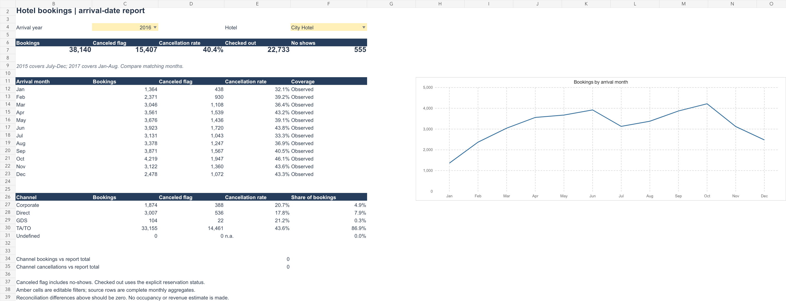
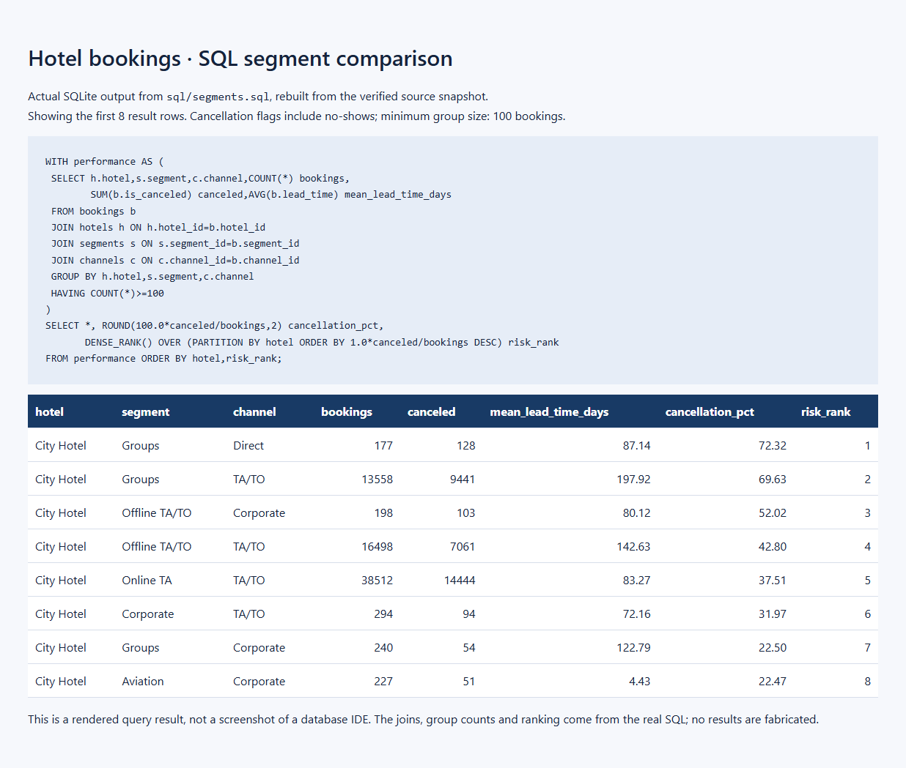
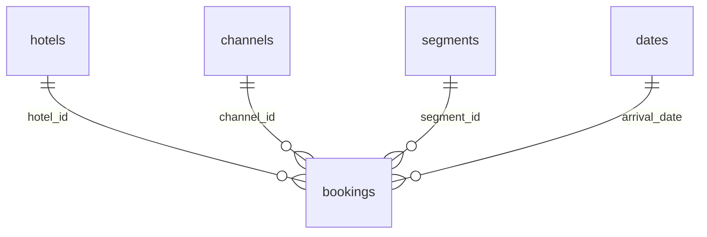
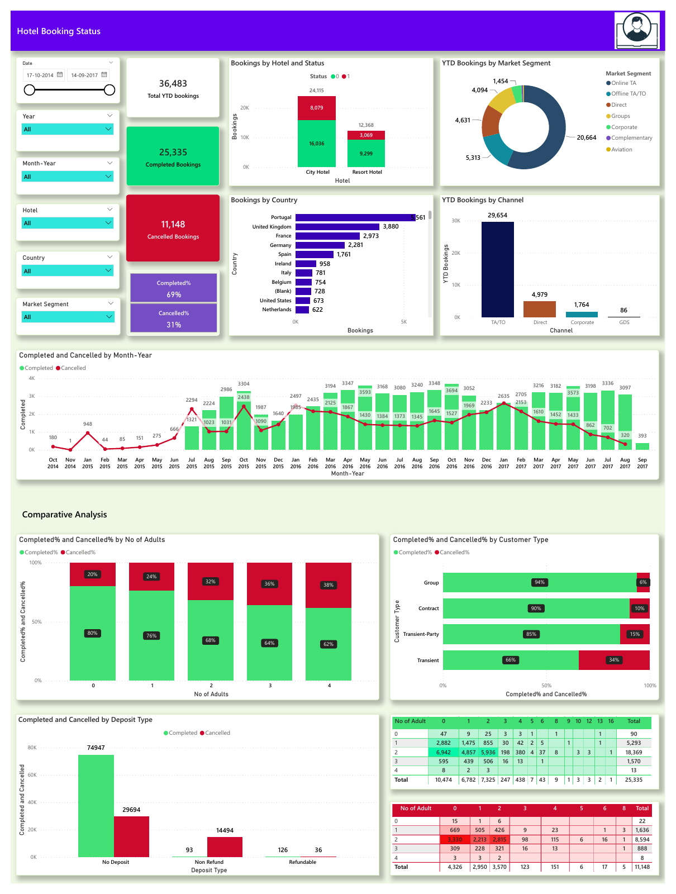

# Hotel Booking Cancellation Analysis

**Start here:** [Excel report](excel/Hotel%20Reporting.xlsx) → [SQL model](sql/schema.sql) → [verified metrics](reports/metrics.json)

[Business question and findings](#findings) · [Excel report](#excel-report) · [SQL case study](#relational-sql-case-study) · [Reproduce](#reproduce-the-analysis) · [Sources and limits](#sources-and-limits)

**Business question:** Where should a hotel team investigate cancellations, and how can it compare performance without confusing dates, booking statuses or partial years?

This case study extends my existing hotel Power BI work with a reproducible SQL model and an interactive Excel report, developed with AI assistance. It uses **119,390 historical bookings** from two Portuguese hotels, with arrivals from July 2015 to August 2017.


## Visual evidence



Actual Excel reporting output with City Hotel and 2016 selected. The filtered preview is a different scope from the complete 119,390-row snapshot.



Rendered output from the actual SQLite segment query: joins, grouped cancellation counts and DENSE_RANK. First eight rows shown; flags include no-shows. This is a query-output capture, not a database-IDE screenshot.

Images are static previews. Open them at full size for detail; follow the reproduction notes to inspect the underlying work.


## Findings

- **44,224 bookings (37.0%)** have the cancellation flag, including **1,207 no-shows**.
- The cancellation flag rate is **41.7% for City Hotel** and **27.8% for Resort Hotel**. Channel and customer mix need investigation before explaining the difference.
- **75,166 bookings** have an explicit Check-Out status. Non-canceled is not assumed to mean a completed stay.
- 2015 and 2017 are partial years. Compare matching months rather than interpreting whole-year totals as growth.

**Suggested next step:** investigate high-volume channel and lead-time segments, then test a targeted confirmation process. No causal retention effect or financial savings is claimed.

## Excel report

[Download the Excel workbook](excel/Hotel%20Reporting.xlsx). Change the year and hotel selectors to explore monthly and channel counts. The workbook uses SUMIFS, count-weighted rates, data validation, a native chart and reconciliation formulas. All six year/hotel combinations were checked against independently calculated source aggregates.

The workbook includes a native source table but **no embedded PivotTable or Power Query connection**. A companion [Power Query M script](excel/ImportMonthly.pq) and [setup instructions](docs/excel-and-powerbi.md) are supplied; they have not been executed in Excel.

## Relational SQL case study



- [Schema and constraints](sql/schema.sql): one fact row per original booking; primary and foreign keys.
- [Monthly analysis](sql/monthly.sql): dimension joins, CTEs, conditional aggregation and LAG for month-to-month comparisons.
- [Segment analysis](sql/segments.sql): hotel, channel and market segment joins, minimum group size and DENSE_RANK.
- [Quality checks](sql/quality.sql): orphan checks and reconciliation of status to cancellation flag.

The full join preserves **119,390 rows**. Every hotel/month SQL booking and cancellation count is independently reconciled to pandas. Original worksheet row numbers serve as technical booking IDs; no claim of business-issued identifiers is made.

## Worked example: cancellation rates by hotel

**Question:** How do cancellation-flag rates compare across the two hotels?

```sql
SELECT h.hotel, COUNT(*) AS bookings,
       SUM(b.is_canceled) AS canceled_flag,
       ROUND(100.0 * SUM(b.is_canceled) / COUNT(*), 1) AS rate_pct
FROM bookings b
JOIN hotels h ON h.hotel_id = b.hotel_id
GROUP BY h.hotel;
```

**Result:** City Hotel **41.7%**, Resort Hotel **27.8%**. Run the query against `reports/hotel.db` after rebuilding the analysis.

**Interpretation:** the difference identifies a question to investigate; it does not establish hotel quality or a causal explanation. The flag includes no-shows, and channel and lead-time mix may differ. [Validation and limitations](reports/findings.md).

## Reproduce the analysis

Python 3.10+; run from this repository's root:

```bash
python -m venv .venv
source .venv/bin/activate
python -m pip install -r requirements.txt
python src/analyze.py
```

On Windows activate with `.venv\Scripts\activate`. The included compressed CSV contains eleven selected source fields plus the original worksheet row number, with all bookings retained. The script creates a SQLite database, normalized model CSVs, reporting summaries and findings in `reports/`. No API key or data download is required. Excel regeneration uses the separately documented builder and runtime in [excel/README.md](excel/README.md).

## Original Power BI work

[Original PBIX](powerbi/Hotel%20Bookings.pbix) · [Original PDF](powerbi/original-dashboard.pdf) · [Companion DAX measures](powerbi/measures.dax)

The original dashboard is preserved as earlier work. Its YTD card shows **36,483**, which differs in scope from the full source, and its date axis includes dates before the first source arrival. The new SQL/Excel metrics use arrival dates consistently. **The PBIX has not been repaired, reopened or refreshed in Power BI Desktop**, and the companion DAX has not been executed. [Rebuild specification and validation totals](docs/excel-and-powerbi.md).



Earlier Power BI artefact, preserved for comparison. Its 36,483 YTD card is not the full 119,390-row snapshot; the date axis precedes the verified arrival range and “Completed” is not a checked-out-stay definition. These known issues are not claimed repaired. Use the verified SQL/Excel outputs above for the full source.

## Sources and limits

Original research: Nuno Antonio, Ana de Almeida and Luis Nunes, *Hotel booking demand datasets*, Data in Brief (2019), [doi:10.1016/j.dib.2018.11.126](https://doi.org/10.1016/j.dib.2018.11.126), CC BY 4.0. This project's local workbook came from the Onyx Data DataDNA July 2023 challenge. [Provenance and SHA-256 fingerprints](data/provenance.json) document the conversion and selected columns.

This is historical educational analysis, not current hotel performance or a client engagement. Identical-looking rows are retained because valid separate bookings can share business fields. No room inventory, costs or payment data is supplied, so occupancy, realized revenue and profit cannot be calculated. Associations do not establish causal effects.

[Detailed findings](reports/findings.md) · [Computed metrics](reports/metrics.json) · [Interview practice notes](docs/interview-notes.md)

## Automated validation

[Validation runs](https://github.com/Kelv-Ojo/hotel-booking-analysis/actions/workflows/validate.yml) rebuild the analysis and check source fingerprints and fixed-snapshot totals. See [reproduction instructions and dependency pins](REPRODUCIBILITY.md). Python checks do not certify native Excel or Power BI behaviour.


## Portfolio review notes

This project is ready to review through its reconciled SQL/Python evidence and genuine Excel screenshot. Headline rates cover all 119,390 source bookings; the screenshot is one selection. Keep the no-show caveat and incomplete-year warning beside comparisons. The original Power BI report is earlier work with unresolved scope/date issues, not a repaired dashboard.

## Business context and skills

Hotel teams need to understand which historical booking groups warrant further investigation. This is descriptive analysis, not proof of preventable cancellations or realised revenue savings.

**Skills demonstrated:** SQL joins and relational grain; Python reconciliation; Excel reporting; cancellation segmentation; clear denominators.

## Portfolio evidence and interview summary

**Demonstrated:** relational SQL modelling, joins, denominator reconciliation and Excel reporting across 119,390 historical records. The verified Excel/SQL case is the principal evidence. The older Power BI artefact has separate date/status limitations and is not used to certify the Excel output. Explain why cancellation flags include no-shows, why filtered screenshots differ from full-snapshot totals, and why partial arrival years must not be treated as complete comparable years. A proposed confirmation trial needs matched periods and channel/lead-time checks before any causal claim.

## Complete-year case study

[Which 2016 arrival month had the most bookings?](docs/PEAK-MONTH-CASE-STUDY.md) includes a reproducible query, interpretation and three-minute walkthrough script. The personal recording remains outstanding. A [24-visual static inventory](docs/HOTEL-VISUAL-INVENTORY.json) records the original PBIX configuration; this is not native measure certification.
