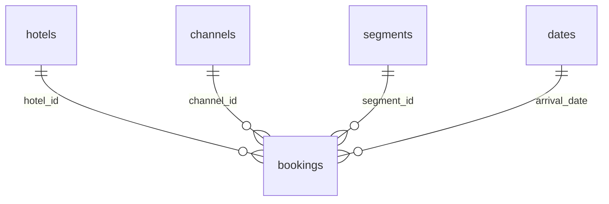
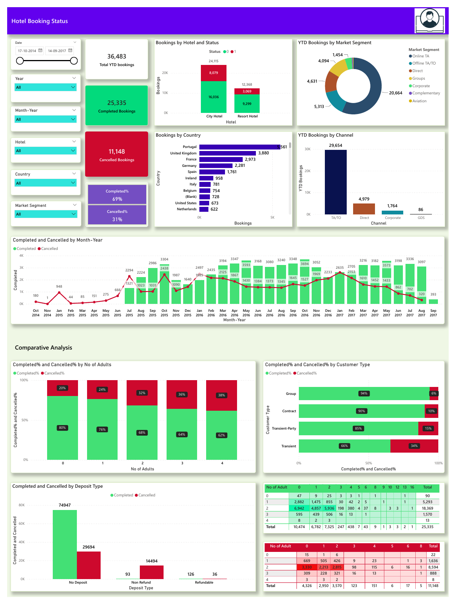

# Hotel Booking Cancellation Analysis

**Business question:** Where should a hotel team investigate cancellations, and how can it compare performance without confusing dates, booking statuses or partial years?

This case study extends my existing hotel Power BI work with a reproducible SQL model and an interactive Excel report, developed with AI assistance. It uses **119,390 historical bookings** from two Portuguese hotels, with arrivals from July 2015 to August 2017.

## Findings

- **44,224 bookings (37.0%)** have the cancellation flag, including **1,207 no-shows**.
- The cancellation flag rate is **41.7% for City Hotel** and **27.8% for Resort Hotel**. Channel and customer mix need investigation before explaining the difference.
- **75,166 bookings** have an explicit Check-Out status. Non-canceled is not assumed to mean a completed stay.
- 2015 and 2017 are partial years. Compare matching months rather than interpreting whole-year totals as growth.

**Suggested next step:** investigate high-volume channel and lead-time segments, then test a targeted confirmation process. No causal retention effect or financial savings is claimed.

## Excel report


[Download the Excel workbook](excel/Hotel%20Reporting.xlsx). Change the year and hotel selectors to explore monthly and channel counts. The workbook uses SUMIFS, count-weighted rates, data validation, a native chart and reconciliation formulas. All six year/hotel combinations were checked against independently calculated source aggregates.

The workbook includes a native source table but **no embedded PivotTable or Power Query connection**. A companion [Power Query M script](excel/ImportMonthly.pq) and [setup instructions](docs/excel-and-powerbi.md) are supplied; they have not been executed in Excel.

## Relational SQL case study



- [Schema and constraints](sql/schema.sql): one fact row per original booking; primary and foreign keys.
- [Monthly analysis](sql/monthly.sql): dimension joins, CTEs, conditional aggregation and LAG for month-to-month comparisons.
- [Segment analysis](sql/segments.sql): hotel, channel and market segment joins, minimum group size and DENSE_RANK.
- [Quality checks](sql/quality.sql): orphan checks and reconciliation of status to cancellation flag.

The full join preserves **119,390 rows**. Every hotel/month SQL booking and cancellation count is independently reconciled to pandas. Original worksheet row numbers serve as technical booking IDs; no claim of business-issued identifiers is made.

## Reproduce the analysis

Python 3.10+; run from this repository's root:

```bash
python -m venv .venv
source .venv/bin/activate
python -m pip install -r requirements.txt
python src/analyze.py
```

On Windows activate with `.venv\Scripts\activate`. The included compressed CSV contains eleven selected source fields plus the original worksheet row number, with all bookings retained. The script creates a SQLite database, normalized model CSVs, reporting summaries and findings in `reports/`. No API key or data download is required. Excel regeneration uses the separately documented builder and runtime in [excel/README.md](excel/README.md).

## Original Power BI work



[Original PBIX](powerbi/Hotel%20Bookings.pbix) · [Original PDF](powerbi/original-dashboard.pdf) · [Companion DAX measures](powerbi/measures.dax)

The original dashboard is preserved as earlier work. Its YTD card shows **36,483**, which differs in scope from the full source, and its date axis includes dates before the first source arrival. The new SQL/Excel metrics use arrival dates consistently. **The PBIX has not been repaired, reopened or refreshed in Power BI Desktop**, and the companion DAX has not been executed. [Rebuild specification and validation totals](docs/excel-and-powerbi.md).

## Sources and limits

Original research: Nuno Antonio, Ana de Almeida and Luis Nunes, *Hotel booking demand datasets*, Data in Brief (2019), [doi:10.1016/j.dib.2018.11.126](https://doi.org/10.1016/j.dib.2018.11.126), CC BY 4.0. This project's local workbook came from the Onyx Data DataDNA July 2023 challenge. [Provenance and SHA-256 fingerprints](data/provenance.json) document the conversion and selected columns.

This is historical educational analysis, not current hotel performance or a client engagement. Identical-looking rows are retained because valid separate bookings can share business fields. No room inventory, costs or payment data is supplied, so occupancy, realized revenue and profit cannot be calculated. Associations do not establish causal effects.

[Detailed findings](reports/findings.md) · [Computed metrics](reports/metrics.json) · [Interview practice notes](docs/interview-notes.md)
